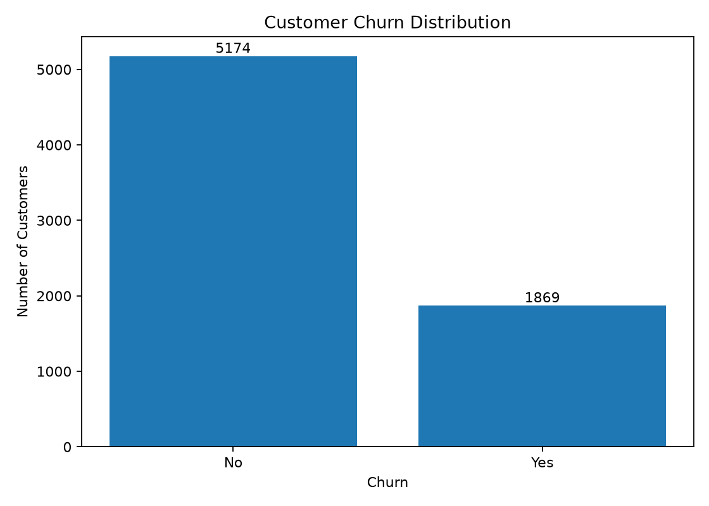
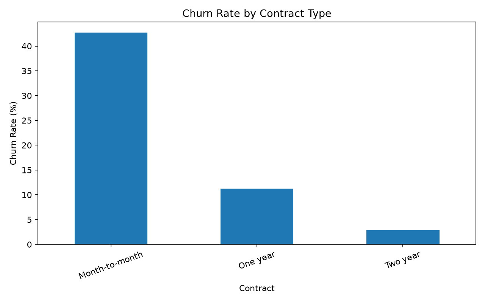
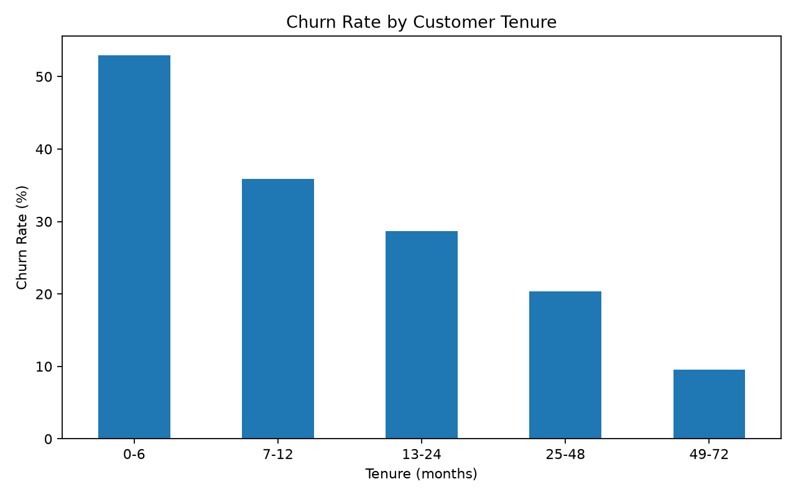
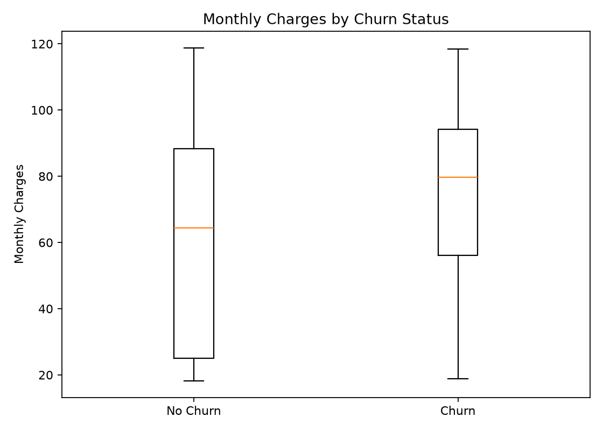
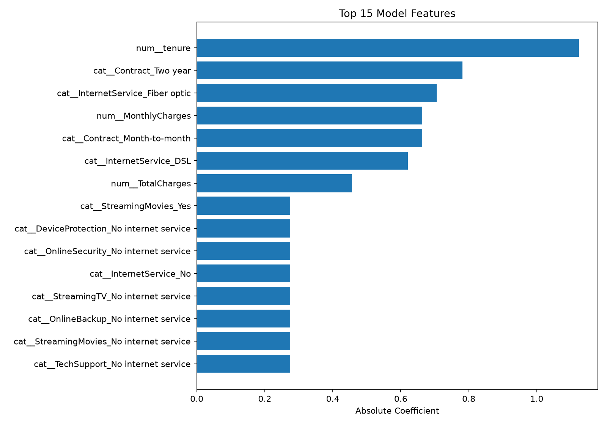

# Customer Churn Prediction

A machine learning project to analyze customer churn, compare classification models, identify high-risk customers, and translate model results into actionable business insights.

## Project Overview

Customer churn occurs when customers stop using a company's products or services. Identifying customers who are likely to leave can help businesses improve retention, optimize customer engagement, and reduce revenue loss.

This project analyzes the IBM Telco Customer Churn dataset and compares two classification models:

- **Logistic Regression** — an interpretable baseline model.
- **Random Forest** — a nonlinear ensemble model.

The project includes exploratory analysis, model evaluation, feature importance analysis, customer risk segmentation, and visual reports.

## Key Results

### Model Performance

| Metric | Logistic Regression | Random Forest |
|---|---:|---:|
| Accuracy | 73.81% | **76.01%** |
| Precision | 50.43% | **53.61%** |
| Recall | **78.34%** | 71.39% |
| F1-score | **61.36%** | 61.24% |
| ROC-AUC | **0.8413** | 0.8351 |

### Interpretation

**Logistic Regression is the stronger choice when the priority is identifying customers who may churn.** It achieves higher recall and ROC-AUC, with a marginally higher F1-score.

- **Accuracy:** Random Forest correctly classifies a larger proportion of customers overall.
- **Precision:** Random Forest has fewer false-positive predictions relative to its positive predictions.
- **Recall:** Logistic Regression identifies a larger proportion of actual churners. Its recall of 78.34% means it detects approximately 78 out of every 100 customers who actually churn.
- **F1-score:** Both models offer similar balance between precision and recall.
- **ROC-AUC:** Both models discriminate reasonably well between churners and non-churners, with a slight advantage for Logistic Regression.

For a retention campaign, missing a customer who is about to leave can be costly. Therefore, Logistic Regression may be preferable when recall is the main business objective. The final choice should also consider retention campaign costs, customer lifetime value, and the cost of false alarms.

## Customer Churn Analysis

### 1. Churn Distribution



**Interpretation**

The dataset contains 7,043 customers, with an actual churn rate of **26.54%**. This means approximately one in four customers has churned.

The target classes are imbalanced: non-churners outnumber churners. Consequently, accuracy alone is not sufficient for evaluating the models. Recall, precision, F1-score, and ROC-AUC provide additional insight into performance.

### 2. Churn Rate by Contract Type



**Interpretation**

Contract type is an important dimension for understanding customer retention. Month-to-month customers typically have less commitment than customers on one-year or two-year contracts.

The chart helps compare churn rates across contract groups and identify segments that may benefit from retention incentives, longer-term plans, or targeted engagement.

**Business implication:** Prioritize retention strategies for contract segments with the highest observed churn rate, while validating that the proposed interventions are cost-effective.

### 3. Churn by Customer Tenure



**Interpretation**

Tenure represents the length of time a customer has stayed with the company. Customer tenure is the strongest feature by absolute coefficient in the Logistic Regression results.

Churn is often concentrated among newer customers. If the chart confirms this pattern, it suggests that onboarding, early customer support, and engagement during the first months of service could be particularly important.

**Business implication:** Consider an early-life retention program for new customers, with additional support during the periods that show elevated churn.

### 4. Monthly Charges by Churn Status



**Interpretation**

This chart compares monthly charges between customers who churned and those who stayed.

Differences between the distributions can help identify whether pricing, service bundles, or perceived value may be associated with churn. However, a difference in charges does not prove that price causes customers to leave.

**Business implication:** Investigate whether high-churn customer segments have expensive plans, insufficient perceived value, or service combinations that could be improved.

## Feature Importance and Model Interpretation

### 5. Top Predictive Features



**Interpretation**

The Logistic Regression coefficient analysis identifies several important predictors:

1. `tenure`
2. `Contract_Two year`
3. `InternetService_Fiber optic`
4. `MonthlyCharges`
5. `Contract_Month-to-month`
6. `InternetService_DSL`
7. `TotalCharges`

The absolute coefficient values measure the magnitude of the estimated effects on the model's log-odds scale, subject to feature encoding and scaling. They do not indicate whether a feature increases or decreases churn.

For example, the absolute coefficient for `tenure` is approximately 1.124, making it the largest coefficient magnitude in the supplied results.

**Important distinction:** These are Logistic Regression coefficient magnitudes, not necessarily Random Forest feature importances. The direction of each relationship must be determined from the signed coefficients and the relevant reference categories.

Contract type, tenure, service type, and customer charges are useful areas for further investigation. These associations are predictive rather than proof of causation.

## Customer Risk Segmentation

The analysis covers all **7,043 customers** and assigns each customer to a predicted risk group.

| Risk group | Customers | Share of customers |
|---|---:|---:|
| High risk | 2,349 | 33.35% |
| Medium risk | 1,722 | 24.45% |
| Low risk | 2,972 | 42.20% |
| **Total** | **7,043** | **100.00%** |

The actual churn rate of 26.54% and the predicted high-risk share of 33.35% measure different things. The former is based on observed outcomes, while the latter depends on the model's risk-scoring method and classification thresholds.

### Recommended Business Actions

- **High-risk customers:** Consider personalized retention offers, proactive service outreach, and investigation of service or billing issues.
- **Medium-risk customers:** Monitor engagement and use targeted communication or customer satisfaction surveys.
- **Low-risk customers:** Focus on customer satisfaction, loyalty, and maintaining service quality.

Risk categories should be validated against actual churn outcomes before being used to allocate a retention budget. Their business value depends on calibration, threshold selection, and the cost-effectiveness of interventions.

## Visual Report Summary

| Figure | Purpose |
|---|---|
| `churn_distribution.png` | Understand the balance between churn and non-churn customers |
| `churn_by_contract.png` | Compare churn across contract types |
| `churn_by_tenure.png` | Explore the relationship between tenure and churn |
| `monthly_charges_by_churn.png` | Compare monthly charges by churn status |
| `top_feature_importance.png` | Identify influential predictive features |

All figures are stored in `reports/figures/`.

## Project Structure

```text
customer-churn-prediction/
├── data/
│   ├── raw/
│   └── processed/
├── notebooks/
│   ├── 01_exploratory_data_analysis.ipynb
│   ├── 02_feature_engineering.ipynb
│   ├── 03_model_comparison.ipynb
│   └── 04_model_interpretation.ipynb
├── reports/
│   ├── figures/
│   └── tables/
├── scripts/
│   ├── check_data.py
│   ├── train_models.py
│   ├── analyze_churn.py
│   └── run_pipeline.py
├── src/
│   └── churn_prediction/
├── tests/
├── pyproject.toml
└── requirements.txt
```

## Getting Started

### Requirements

- Python 3.10 or newer
- pandas
- NumPy
- scikit-learn
- Matplotlib
- Seaborn
- Jupyter

### Installation

Clone the repository and enter the project directory:

```bash
git clone https://github.com/AZFARHAD24511/customer-churn-prediction.git
cd customer-churn-prediction
```

Create and activate a virtual environment.

**Windows PowerShell:**

```powershell
python -m venv .venv
.\.venv\Scripts\Activate.ps1
pip install -r requirements.txt
```

Place the Telco Customer Churn CSV in the expected raw-data directory before running the pipeline. Check the project scripts for the exact dataset filename and path.

### Run the Analysis

```powershell
python scripts/check_data.py
python scripts/train_models.py
python scripts/analyze_churn.py
```

Alternatively, use the pipeline entry point if its configuration and input-data requirements are satisfied:

```powershell
python scripts/run_pipeline.py
```

## Limitations

- Results depend on the dataset, preprocessing, feature encoding, train/test split, and classification thresholds.
- The reported metrics do not establish how well the models will perform on future customers or different companies.
- Feature associations do not establish causality.
- Risk segmentation should be assessed using business costs and validation on unseen data.
- Accuracy, precision, and recall can change with the decision threshold; ROC-AUC evaluates ranking performance across thresholds.

## Conclusion

Both models provide useful signals for customer retention. Random Forest achieves higher accuracy and precision, while Logistic Regression delivers higher recall, F1-score, and ROC-AUC in the reported evaluation.

When the primary goal is to identify as many potential churners as possible, Logistic Regression is a promising starting point. The next step is to validate risk scores and evaluate retention strategies using customer-level costs, expected benefits, and actual intervention outcomes.

## Technologies

Python · pandas · NumPy · scikit-learn · Matplotlib · Seaborn · Jupyter · Git
